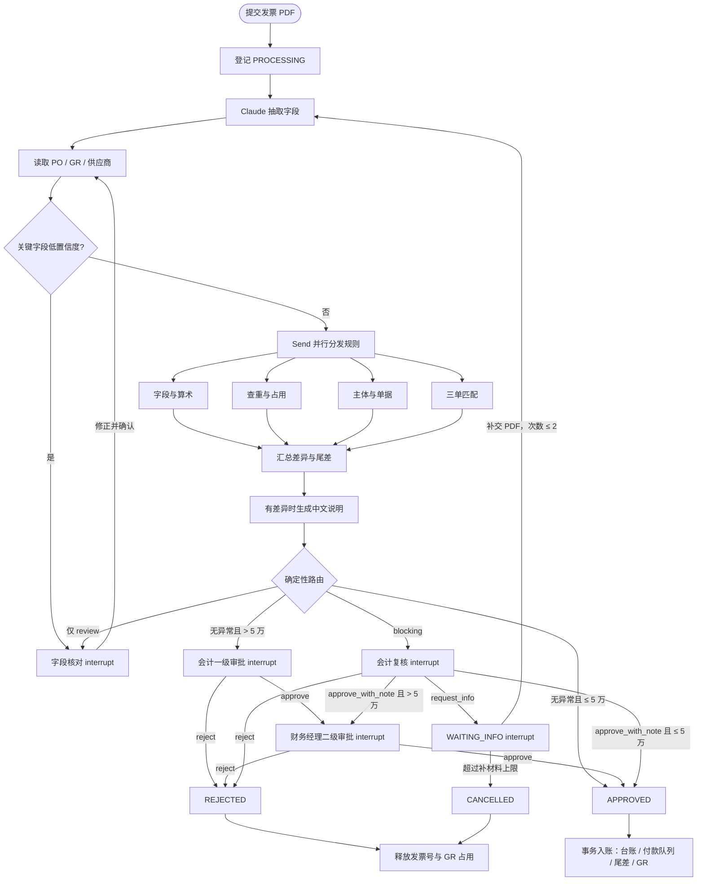

# 采购发票审核 Agent

采购发票进入付款队列之前，需要与采购单、收货单和供应商主数据核对。本项目接收可提取文本的发票 PDF，从模拟 ERP 读取结构化 PO / GR，完成三单匹配、人工复核和应付入账。

**LLM 只负责「读」和「说」，规则负责下结论。** Claude 抽取发票字段与置信度，并把差异写成中文说明；金额计算、查重、审批路由和最终状态均由确定性 Python 代码决定。通过审核只写入模拟付款队列，不会实际付款。

技术栈：Python 3.11+、LangGraph、FastAPI、Pydantic v2、SQLite、Anthropic SDK、pdfplumber、ReportLab。审核页使用 Jinja2 和原生 JavaScript，无前端构建步骤。

## 快速运行

```sh
docker compose up --build
```

打开 [审核页](http://localhost:8000/review)，上传 `data/invoices/` 中的示例 PDF。小额正常票自动通过，大额票需要会计和财务经理两级审批，问题票进入会计复核。接口文档在 [Swagger UI](http://localhost:8000/docs)，健康检查为 `GET /health`。

默认使用 `replay`，无需 API Key。仓库中的缓存是明确标记为 `synthetic` 的合成夹具，只覆盖示例票据；上传陌生 PDF 时，请配置 `live` 或 `record` 及有效的 Claude API Key。replay 缓存缺失会报错，不会调用模型或根据标签伪造抽取结果。

容器使用非 root 用户。业务数据库、LangGraph 检查点和上传文件保存在挂载到 `/app/runtime` 的 `audit-data` 卷中；重启服务后仍可继续待办。`docker compose down` 保留该卷，`docker compose down -v` 会删除全部审核记录与上传文件。

## 本地开发

```sh
python3.11 -m venv .venv
source .venv/bin/activate
python -m pip install -r requirements.lock
python -m pip install --no-deps -e .
cp .env.example .env
python -m uvicorn app.main:app --reload
```

示例数据和离线缓存已提交，无需在启动时重建。需要重新生成固定种子数据时运行：

```sh
python -m data.generate --with-explanations
```

策略集中在 [`config/policy.yaml`](config/policy.yaml)，经 Pydantic 校验。金额使用 `Decimal` 和 `ROUND_HALF_UP`；合计保留两位小数，PO 单价保留原始精度，支持四位小数的精确比较。SQLite 金额列使用 Decimal 字符串 TEXT。

真实抽取可在 `.env` 中设置：

```dotenv
LLM_MODE=record
LLM_MODEL=claude-sonnet-4-6
ANTHROPIC_API_KEY=your-key
```

`live` 直接调用 Claude；`record` 调用 Claude 并保存请求与响应；`replay` 只读取缓存。缓存键包含任务、版本化提示词、模型、输入和输出 Schema。提示词保存在 [`app/services/prompts/`](app/services/prompts/)。请勿将真实业务发票或含敏感内容的录制缓存提交到公开仓库。

## 审核规则

各条规则都是 `(AuditContext) -> list[Finding]` 纯函数。规则不调用模型、不写数据库；除关键字段缺失外，全部规则执行后统一汇总差异。

| 规则 | 内容 | 异常码 | 严重度 |
| --- | --- | --- | --- |
| R01 | 发票号、日期、销购方税号、PO / GR 号、三个合计和明细齐全 | `MISSING_FIELD` | blocking |
| R02 | 关键字段置信度不低于 0.85 | `LOW_CONFIDENCE` | review |
| R03 | 数量 × 单价、行金额合计与行税额合计差额各 ≤ 0.01 元；不含税合计 + 税额严格等于价税合计 | `ARITHMETIC_ERROR` | blocking |
| R04 | 销方税号 + 发票号未被其他处理中或已入账发票使用 | `DUPLICATE_INVOICE` | blocking |
| R05 | 购方名称和税号与公司配置一致；名称去首尾空格并全角转半角 | `BUYER_MISMATCH` | blocking |
| R06 | 销方为 active 供应商，且与 PO 的供应商相同 | `VENDOR_NOT_APPROVED` / `VENDOR_PO_MISMATCH` | blocking |
| R07 | PO / GR 存在且对应，GR 未被其他发票占用 | `PO_NOT_FOUND` / `GR_NOT_FOUND` / `GR_ALREADY_INVOICED` | blocking |
| R08 | 发票按 SKU 对应 PO 行，再按 `po_line_no` 对应 GR 行 | `LINE_NOT_ON_PO` | blocking |
| R09 | 发票数量等于 GR 收货数量 | `QTY_MISMATCH` | blocking |
| R10 | 不含税单价和税率与 PO 精确一致 | `PRICE_MISMATCH` / `TAX_RATE_MISMATCH` | blocking |
| R11 | 与按 PO 单价 × GR 数量逐行舍入后求和的差额不超过 1.00 元 | `AMOUNT_OVER_TOLERANCE` | blocking |
| R12 | 价税合计超过 50,000.00 元时走两级审批 | 影响路由，无异常码 | — |

`blocking` 交由会计处理；仅有 `review` 时先核对字段，再重新加载 ERP 上下文并重跑规则。R01 失败时仍执行 R02，跳过 R03–R11。

R11 的非零允许差额记入 `ROUNDING_VARIANCE`。R11 不会豁免 R03：发票内部算术仍须成立；一张票可能同时出现算术错误与超额差异。单价差 `0.0001` 也会触发 R10。

## 流程与人工动作



会计复核支持 `approve_with_note`、`reject`、`request_info`，均需说明理由。两级审批分别由 `ap_clerk` 和 `finance_manager` 执行，只能 `approve` 或 `reject`。补材料保留占用，补交后重新抽取；超过配置上限取消并释放占用。

审核中的发票只登记占用。批准后才原子写入应付台账、付款队列及尾差，并标记 GR。`run_id` 和发票唯一索引保证重复执行不会重复入账；人工认可差异也不能突破发票与 GR 的全局唯一性。每个节点和人工决定均有审计记录。

## API

| 方法 | 路径 | 用途 |
| --- | --- | --- |
| POST | `/runs` | multipart 上传 PDF，执行至待办或结束 |
| GET | `/runs?status=` | 按状态查询列表 |
| GET | `/runs/{run_id}` | 字段、差异、说明、决定和当前待办 |
| POST | `/runs/{run_id}/resume` | 提交人工动作 |
| POST | `/runs/{run_id}/documents` | WAITING_INFO 时补交 PDF 并继续 |
| GET | `/runs/{run_id}/audit` | 节点审计日志 |
| GET | `/review` | 审核页面 |
| GET | `/health` | 健康检查 |

人工动作请求体为 `{ "action": "reject", "note": "购方税号有误" }`，字段核对使用 `corrected_fields`。请求头 `X-User-Role` 模拟 `ap_clerk` 或 `finance_manager`。**这只是演示角色，不能充当生产身份认证。** 不提供注册、登录或 JWT。

不合法的动作、角色或状态返回 400 / 409，且不改变运行状态。同一运行并发恢复使用数据库 CAS 锁，只有一个请求能够推进同一版本。

## 数据集与评测

固定种子 `20260617` 生成 200 张中文文本 PDF、对应 ERP 数据和逐字段真值。12 家供应商中包含 1 家 blocked。每张 PO 有 2–6 行，单价有 2–4 位小数，税率覆盖 13% / 9% / 6%。

| 样本 | 数量 |
| --- | ---: |
| 正常小额发票 | 115 |
| 允许尾差的正常票 | 20 |
| 需两级审批的大额正常票 | 25 |
| 数量不符 | 7 |
| 单价不符 | 6 |
| 总额超过容差 | 5 |
| 重复发票 | 5 |
| 购方不符 | 5 |
| 不合格供应商 | 4 |
| GR 不存在或已开票 | 4 |
| 税率不符 | 4 |

每张问题票只修改一个业务原因；该原因触发的派生异常也记录于 `labels.json`。审核程序不会读取标签作业务决定。

```sh
python -m pytest -q
python -m eval.run_eval --mode replay
```

评测自动提交全部发票，问题票由模拟会计驳回，大额票模拟两级批准，字段核对使用真值。结果写入 [`eval/report.md`](eval/report.md)：问题票检出、误报、各异常码检出与漏报、字段准确率、路由准确率、尾差记账正确数、直通率和平均处理耗时。CI 在 replay 模式运行单测和评测；检出少于 36 / 40 或误报超过 8 张时失败。

**当前离线结果衡量合成夹具下的规则与流程，不代表 Claude 真实抽取准确率。** 仓库未把合成响应称为真实录制。需要真实模型指标时，用有效 API Key 运行 `record` / `live` 评测，并保留相应报告来源；简历或产品指标应使用这些实测结果。

本次 replay：问题票检出 **40/40**，正常票误报 **0/160**，首次路由 **200/200**，尾差入账 **20/20**，直通率 **67.50%**。完整分码结果及耗时见评测报告。

测试覆盖各规则通过、失败和边界，包含恰好 1.00 元与 1.01 元、数量多 / 少 1、四位小数价差；另覆盖字段核对、会计驳回、补材料与取消、两级审批、检查点恢复、幂等入账和并发占用。

## 与参考思路的比较

下表按项目需求说明中提供的 Reconcile 对比项整理，仅用于说明本项目的设计取舍。

| 方面 | 需求说明所述 Reconcile 做法 | 本项目 |
| --- | --- | --- |
| PO / GR 来源 | 三份文件均从 PDF 用 LLM 抽取 | PO / GR 从 ERP 结构化记录读取，只抽取发票 |
| 行匹配键 | 商品描述字符串 | SKU 对应 PO 行，再按 `po_line_no` 对应 GR |
| 价格容差 | 单价允许 ±2% | 单价精确相等，仅总额尾差 ≤ 1.00 元可记尾差科目 |
| 写入时机 | 查重节点即写入发票 | 处理中先占用，批准后写应付台账 |
| 审批阈值 | 环境变量字符串 | YAML + Pydantic 校验，金额为 Decimal |
| 金额类型 | float | Decimal、分位合计、ROUND_HALF_UP |
| 风险判断 | ML 异常检测与打分 | 可解释规则与异常码 |
| 补材料 | 无 | 暂停、补交 PDF、重新抽取与审核 |
| 评测 | 15 张小基准 | 200 张合成发票，包含 40 张问题票，CI replay |

整体流程思路参考了 [Reconcile](https://github.com/pratyakshagarwal/Reconcile)，代码为独立实现。仅借鉴 LangGraph 并行分发、持久化人工复核和恢复接口的整体思路，未复制其代码、提示词或文案。本项目使用 [MIT License](LICENSE)。

## 架构与演示

分层与持久化约束见 [`docs/architecture.md`](docs/architecture.md)。

演示视频 / GIF：预留 `docs/demo.gif`，待录制后补充。
